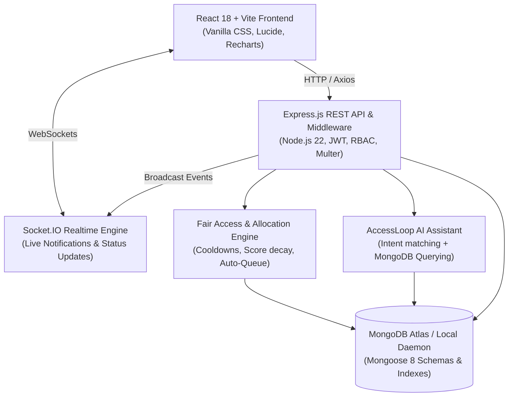
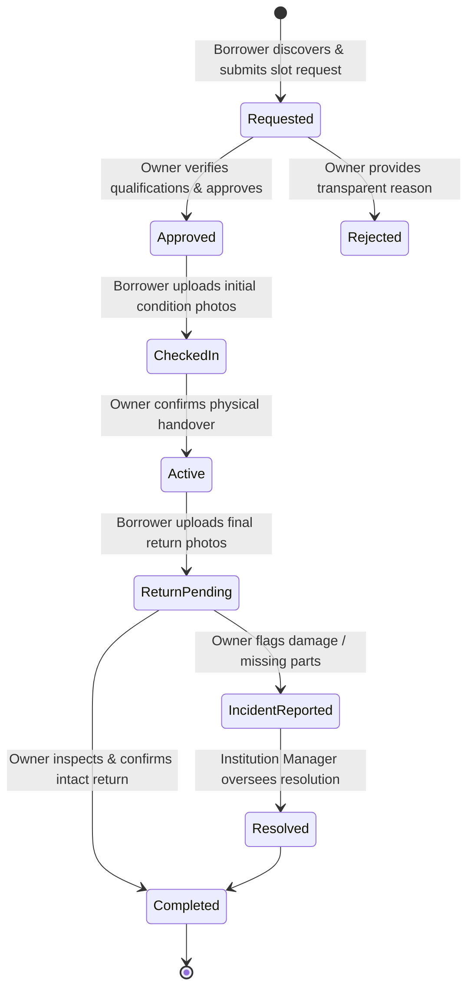
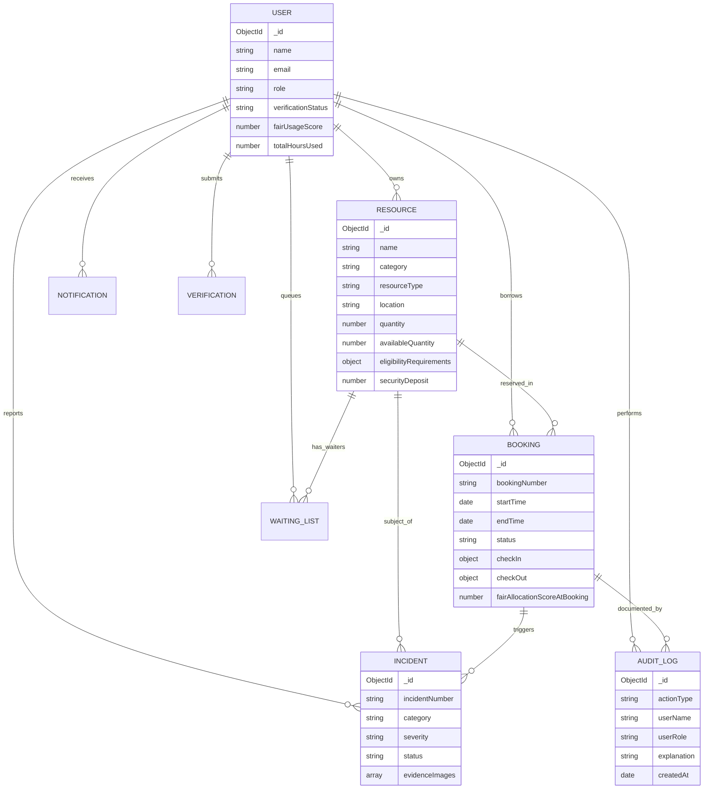

# AccessLoop | Smart, Trusted & Fair Resource Sharing Ecosystem

> **Problem Statement:** *"Unlock Underused Equipment and Spaces – Build a trusted platform that helps institutions and communities safely share underused spaces, equipment and technical resources."*

AccessLoop is a production-grade, full-stack resource-sharing web ecosystem engineered for universities, laboratories, makerspaces, and community institutions. It bridges the gap between valuable, underutilized institutional assets and eligible students, researchers, and creators through a complete 5-step trusted lifecycle:

$$\text{LIST} \longrightarrow \text{DISCOVER} \longrightarrow \text{VERIFY} \longrightarrow \text{REQUEST} \longrightarrow \text{APPROVE} \longrightarrow \text{CHECK-IN} \longrightarrow \text{USE} \longrightarrow \text{RETURN} \longrightarrow \text{VERIFY CONDITION} \longrightarrow \text{COMPLETE} \longrightarrow \text{AUDIT}$$

---

## 🌟 Key Highlights & Core Innovation

- **Dominant White & Bright-Green Design System (`#22C55E`):** Clean, premium modern SaaS aesthetic following human-centered typography and micro-interactions.
- **Global AI Assistant ("Ask AI"):** Top-left persistent assistant logo querying live MongoDB inventory to guide users on bookings, returns, and safety requirements without requiring a paid API key.
- **Fair Access & Allocation Engine:** Transparent algorithmic scoring that prevents resource monopolization, enforces consecutive reservation cooldowns, and automates waiting list queues.
- **Two-Sided Photographic Condition Documentation:** Check-in collection proof and return condition inspection prevent disputes and protect high-value equipment.
- **Human Oversight on Incidents:** Machine learning or automated algorithms are never allowed to impose punitive actions or claim deductions independently.
- **Immutable Ledger:** Full audit history tracking every state change, actor, and timestamp.
- **1-Click Demo Account Switcher:** Built directly into the navigation bar for judges and evaluators to test all 4 role perspectives seamlessly.

---

## 👥 Demo Login Credentials

The database is pre-seeded with 16 realistic resources, 10 diverse users across 4 roles, active reservations, incident reports, and audit logs. All passwords are set to `Password123!`.

| Role | Name | Email | Password | Primary Permissions |
| :--- | :--- | :--- | :--- | :--- |
| **👑 Platform Admin** | Administrator | `admin@accessloop.edu` | `Password123!` | System settings, platform analytics, audit ledger, user management |
| **🏛️ Institution Manager** | Dr. Evelyn Vance | `manager@accessloop.edu` | `Password123!` | Identity/ID verifications, conflict monitoring, incident dispute resolution |
| **🔬 Resource Owner (Robotics)** | Dr. Ramesh Sharma | `dr.sharma@accessloop.edu` | `Password123!` | List equipment, approve/reject requests, verify handovers & returns |
| **🎬 Resource Owner (Media)** | Prof. Maya Sen | `media.prof@accessloop.edu` | `Password123!` | Custodian for Sony Cinema rigs, audio booths, and AR/VR studio |
| **🔬 Resource Owner (Optics)** | John Reynolds | `lab.tech@accessloop.edu` | `Password123!` | Custodian for Class 4 Laser lab, cleanrooms, and research microscopes |
| **🎓 Borrower (Student)** | Arun Kumar | `arun.student@accessloop.edu` | `Password123!` | Discover resources, check eligibility, check-in with photos, return |
| **🧬 Borrower (Researcher)** | Priya Menon | `priya.researcher@accessloop.edu` | `Password123!` | Ph.D. scholar holding specialized fluorescence & cleanroom clearances |
| **🎨 Borrower (Creator)** | Kavya Nair | `kavya.creator@accessloop.edu` | `Password123!` | Media student accessing 4K cameras & podcast recording studios |

---

## 📊 System Architecture & Diagrams

### 1. System Architecture Diagram



---

### 2. Complete 5-Step Resource Sharing Lifecycle



---

### 3. Entity-Relationship (ER) Diagram



---

## 🛠️ Technology Stack

| Layer | Technologies |
| :--- | :--- |
| **Frontend** | React 18, Vite 6, JavaScript (ES6+), React Router DOM 6, Axios, Lucide React, Recharts, Socket.IO Client |
| **Styling** | Custom Vanilla CSS Design System (White dominant, `#22C55E` bright green highlights, responsive grid, micro-animations) |
| **Backend** | Node.js 22, Express.js 4, RESTful Architecture, JWT Authentication, bcryptjs password hashing, Multer, Socket.IO 4 |
| **Database** | MongoDB Atlas / Local MongoDB, Mongoose 8 (with automatic `mongodb-memory-server` fallback for zero-config testing) |
| **Deployment** | Vercel (Frontend SPA rewrite configuration), Render (Backend web service manifest), MongoDB Atlas |

---

## 🚀 Quick Start Guide

### Prerequisites
- Node.js v18+ (tested on Node v22.23.2)
- npm v9+

### 1. Clone & Install Dependencies

```bash
git clone https://github.com/your-username/accessloop.git
cd accessloop

# Install root, backend and frontend dependencies
npm run install:all
```

### 2. Seed Database with Realistic Data

```bash
# Seed 16 resources, 10 users, sample bookings, incidents and audit history
npm run seed
```

### 3. Launch Development Servers

You can launch both servers using separate terminals or using the root scripts:

```bash
# Terminal 1: Backend Server (Port 5000)
npm run server

# Terminal 2: Frontend Client (Port 5173)
npm run client
```

Now open **`http://localhost:5173`** in your browser!

---

## 🎬 End-to-End DSLR Camera Sharing Scenario

To verify the complete lifecycle requested in the problem statement:

1. **Owner View:** Sign in as `dr.sharma@accessloop.edu` or `media.prof@accessloop.edu`. Click **List Resource** to list a new camera or check your active equipment catalog.
2. **Student View:** Switch role to **Student** (`arun.student@accessloop.edu`) via the Demo Switcher in the navbar.
3. **Discovery:** Click **Explore Resources**, filter by **Cameras**, and open the **Sony Alpha A7 IV Full-Frame Cinema Rig**.
4. **Eligibility Check:** The page displays your green **Verified Student** badge and **100/100 Fair Usage Score**.
5. **Reservation:** Select tomorrow's date, choose 9:00 AM - 1:00 PM, enter purpose `"Documentary interview series on sustainable campus technology"`, and click **Submit Booking Request**.
6. **Owner Approval:** Switch to the resource owner (`media.prof@accessloop.edu`). Go to the **Owner Dashboard**, find the pending request, review applicant purpose, and click **Approve Request**.
7. **Check-In Handover:** Switch back to Student. On the booking page, click **Complete Check-In & Photos**, enter condition notes and upload initial collection photos.
8. **Activation:** Switch to Owner and click **Confirm Handover & Activate**. The booking status updates to **Active** in real-time.
9. **Return Request:** Switch to Student. After usage, click **Request Return & Submit Photos**, upload clean condition photographs. Status becomes **Return Pending**.
10. **Inspection & Completion:** Switch to Owner. Click **Inspect Return & Complete**, verify no damage occurred, and complete the booking. The booking status transitions to **Completed** and the user's completed sessions count increments.
11. **Immutable Audit:** Switch to **Administrator** (`admin@accessloop.edu`), open **Audit Trail** (`/audit-logs`), and observe every state shift (`booking_submitted` $\rightarrow$ `booking_approved` $\rightarrow$ `check_in_completed` $\rightarrow$ `return_confirmed`) preserved with timestamps and actor IDs.

---

## 🛡️ Security, Privacy & Compliance

- **Role-Based Access Control (RBAC):** Backend route guards (`protect`, `authorize`) prevent privilege escalation. Borrowers cannot review verifications, approve bookings, or mutate other users' reservations.
- **Rate Limiting:** Express rate limiting prevents automated brute-force attacks (`express-rate-limit`).
- **Input Sanitization & Validation:** Mongoose schemas enforce data boundaries, string trimming, and email regex checks.
- **Secure File Storage:** Multer handles isolated file uploads with size restrictions and extension allowlisting.
- **No Machine Learning Disciplinary Penalties:** Damage disputes and penalty points are always subject to human approval by Institution Managers.

---

## ☁️ Deployment Instructions

### Frontend (Vercel)
1. Push repository to GitHub.
2. Connect repository to [Vercel](https://vercel.com).
3. Set **Root Directory** to `client`.
4. Ensure `client/vercel.json` is committed for SPA routing.
5. Set `VITE_API_URL` environment variable to your production backend URL.

### Backend (Render)
1. Create a new Web Service on [Render](https://render.com).
2. Set **Root Directory** to `server`.
3. Build Command: `npm install`
4. Start Command: `node server.js`
5. Configure Environment Variables:
   - `MONGODB_URI`: Your MongoDB Atlas connection string (`mongodb+srv://...`)
   - `JWT_SECRET`: Random 64-character secret key
   - `CLIENT_URL`: Your Vercel frontend URL
   - `NODE_ENV`: `production`

---

## 📜 License

Built with pride for academic institutions and research ecosystems. Open-source under the MIT License.
